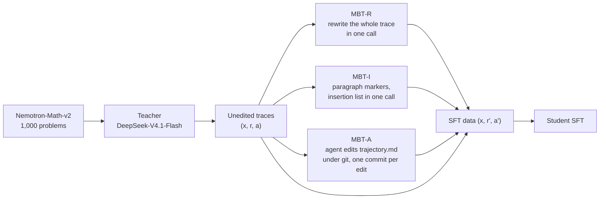

# Usage guide

[Return to the README](../README.md).

## Inputs, outputs and resume

Inputs and outputs are JSONL. A problem row needs `id` and `problem`; a trace row needs `id`,
`problem`, `reasoning`, `response`. The released `traces_unedited` file is a valid input for every
editing command. Commands that call a model save each completed row and skip IDs already in the
output when resumed. Each output has an adjacent `.manifest.json` binding its input rows,
method, settings, implementation and dependency versions. Changed identities and existing
outputs without a manifest are refused. Resume with the original code and configuration, or
choose a new output path. Worker count and row limit can change without creating a new run.
Keep the manifest when moving an output. A concurrent writer is refused. An incomplete final row is preserved in `.recovery/` before
recovery; earlier malformed rows cause an error. If a row fails, completed rows remain saved
and the command exits with an error so it can be retried.

The `sft` converter replaces its output only after conversion succeeds. Input and output must
be different files.

```bash
mbt generate --input examples/problems.jsonl --output out/unedited.jsonl --endpoint deepseek
mbt rewrite  --input examples/traces.jsonl   --output out/mbt-r.jsonl    --endpoint deepseek
mbt insert   --input examples/traces.jsonl   --output out/mbt-i.jsonl    --endpoint deepseek

docker build -t mbt-editor:latest -f docker/Dockerfile docker
mbt agentic  --input examples/traces.jsonl   --output out/mbt-a.jsonl --sandbox docker \
             --artifacts out/mbt-a-artifacts

mbt sft       --input out/mbt-a.jsonl --output out/sft-mbt-a.jsonl
mbt positions --input out/mbt-a.jsonl
```

Options: `--workers N` (parallel, default 8), `--limit N`, `--model`, `--base-url`,
`--max-tokens`, `--reasoning-effort`, `--extra-body '{...}'`. See `mbt <command> --help`. Each
output row keeps every attempt (request settings, finish reason, usage, raw reply), so a failed
edit records why.

## 🔌 Endpoints

Every call goes through one streaming client speaking `openai` (`POST /chat/completions`) or
`anthropic` (`POST /v1/messages`). Reasoning is read from `reasoning_content`, `reasoning`,
Anthropic `thinking` blocks, or a leading `<think>` block. Keys are read only from environment
variables.

| Preset | Format | Base URL | Key variable |
|---|---|---|---|
| `deepseek` (default) | openai | `https://api.deepseek.com` | `DEEPSEEK_API_KEY` |
| `deepseek-anthropic` | anthropic | `https://api.deepseek.com/anthropic` | `DEEPSEEK_API_KEY` |
| `openai` | openai | `https://api.openai.com/v1` | `OPENAI_API_KEY` |
| `anthropic` | anthropic | `https://api.anthropic.com` | `ANTHROPIC_API_KEY` |
| `openrouter` | openai | `https://openrouter.ai/api/v1` | `OPENROUTER_API_KEY` |
| `openrouter-anthropic` | anthropic | `https://openrouter.ai/api` | `OPENROUTER_API_KEY` |
| `qwen` | openai | `https://dashscope-intl.aliyuncs.com/compatible-mode/v1` | `DASHSCOPE_API_KEY` |
| `qwen-anthropic` | anthropic | `https://dashscope-intl.aliyuncs.com/apps/anthropic` | `DASHSCOPE_API_KEY` |
| `vllm` | openai | `http://localhost:8000/v1` | none |

By default every request uses the paper's sampling (temperature 1.0, top_p 0.95, reasoning effort
`max`); pass `--no-paper-sampling` for models that reject these. Model ids change over time, so
check them with your provider.

```bash
mbt insert  --endpoint openai --model MODEL_ID --no-paper-sampling --reasoning-effort high ...
mbt rewrite --endpoint anthropic --model MODEL_ID --no-paper-sampling --max-tokens 64000 \
            --extra-body '{"thinking": {"type": "enabled", "budget_tokens": 32000}}' ...
mbt insert  --endpoint qwen --model MODEL_ID --no-paper-sampling ...
mbt generate --endpoint vllm --base-url https://my-server/v1 --api-key-env MY_KEY --model my-model ...
```

The MBT-A agent needs an Anthropic-compatible endpoint (DeepSeek, OpenRouter, Qwen Cloud,
Anthropic, or a vLLM server's `/v1/messages`):

```bash
mbt agentic --sandbox docker --base-url https://api.deepseek.com/anthropic \
            --api-key-env DEEPSEEK_API_KEY --model deepseek-flash --input IN --output OUT
```

## 🤖 MBT-A sandbox: Docker and E2B

The agent runs with the paper's harness settings: Claude Code 2.1.283, effort `max`, output limit
128,000 tokens per request, up to 10 retries, context compaction at 917,504 tokens, web search and
fetch withheld, one run of at most 3,600 seconds, 1 CPU and 2 GiB. The working directory holds
only `.git` and `trajectory.md`; the brief is read from outside it and is the agent's only user
message.

```bash
# Docker: runs as your user, the key is passed through a private --env-file
docker build -t mbt-editor:latest -f docker/Dockerfile docker
mbt agentic --sandbox docker --input IN --output OUT --artifacts out/artifacts --workers 4

# E2B: cloud sandboxes, as in the paper
export E2B_API_KEY=...
cd docker && e2b template build && cd ..      # requires the E2B CLI
mbt agentic --sandbox e2b --template mbt-editor --input IN --output OUT --artifacts out/artifacts
```

For an E2B account with a shorter lifetime limit, set both limits, for example
`--timeout-sec 1500 --sandbox-lifetime-sec 1800`.

With `--artifacts`, each trace keeps the agent's `stream-json` transcript, its stderr and a
`git bundle` of the repository. Each output row holds the edited reasoning and response, the commit
list, and every insertion with its behavior and its position in the original reasoning, found by
replaying the commits.

## 🏷️ Annotation and statistics

Two annotation schemes are in `src/mbt/prompts/annotation/`: the 14 undesirable behaviors (D1 to
D14) and 3 desirable ones (P1 to P3) of Appendix B, and the seven target behaviors (B1 to B7) of
Figure H1 with counts and positions. The annotator sees the trace with numbered lines but not
whether the answer is correct; the paper used gpt-6.1-sol at reasoning effort medium.

```bash
mbt annotate --scheme undesirable --endpoint openai --model gpt-6.1-sol --input IN --output OUT
mbt annotate --scheme target      --endpoint openai --model gpt-6.1-sol --input IN --output OUT
```

`src/mbt/stats/` has, in NumPy only, the insertion-position statistics (`positions.py`: share per
tenth and the KS statistic D) and the conditional logistic regression with Firth's penalty
(`clogit.py`) for the association of each behavior with correctness within a problem (Table H1).

## 📝 Prompts

All prompts are in `src/mbt/prompts/`; `mbt prompt NAME` prints a method prompt.
`tests/test_prompts.py`
checks the recorded editing prompt hashes.

| File | Used by | SHA-256 |
|---|---|---|
| `generation.txt` | Teacher generation | |
| `mbt_a_brief.md` | MBT-A (agent's user message) | `956574de7e5672f6...` |
| `mbt_r_instructions.md` | MBT-R | `22d32f8f12ac39aa...` (with `one_call_templates.json`) |
| `mbt_i_instructions.md` | MBT-I | `78bd692d454e667f...` (with `one_call_templates.json`) |
| `annotation/*` | The two annotation schemes | |
| `grading/*` | Reference grading prompts from the appendix | See `grading/sources.json` |

The MBT-R and MBT-I instructions are the MBT-A brief with the repository, editing-tool and commit
parts removed and a short framing and reply format added, so all three carry the same behavior
entries.

The [reference grading prompt guide](../src/mbt/prompts/grading/README.md) lists
parameter markers, source versions and upstream licenses. These are text assets;
no evaluation runner is included.

## 🗂️ Layout

```text
src/mbt/   cli, client, endpoints, trajectory, methods, one_call, agentic, commits,
           sandbox/ (docker, e2b), annotate, stats/, prompts/
docker/    Dockerfile, e2b.Dockerfile, e2b.toml
examples/  two problems and their teacher traces from the released data
tests/     offline tests
```


## Method details

## 🧩 The seven target behaviors

The instructions say **where** each behavior belongs; they never ask for a number of insertions,
and a behavior with no fitting place is not inserted. Every inserted passage names what it examined
and states what it found; nothing is deleted or reordered, and an incorrect step stays in place
with its correction after it.

| Paper name | Name in the prompts |
|---|---|
| Subgoal setting | `subgoal-when-absent` |
| Logical check | `logical-check-in-deduction` |
| Substantive verification | `checkable-verification` |
| Targeted backtracking | `deep-named-return` |
| Resuming abandoned paths | `continue-the-dropped-line` |
| Self-correction | `catch-and-correct` |
| Sufficiency judgment | `closing-decision` |

## 🔧 Method

A training example is a triple (x, r, a): a problem, the teacher's reasoning (inside the thinking
block) and its response (after it). A strategy returns an edited (r', a'), and the student is
trained on (r', a'). The editor receives the problem and the two sections, **never the reference
answer**, and may not look the problem up.



All three strategies use the teacher itself as the editor and share the same behavior
instructions. They differ in how the editor works and what it outputs.

| | MBT-R (rewrite) | MBT-I (insert) | MBT-A (agentic) |
|---|---|---|---|
| Output | The whole edited reasoning and response | A list of (marker, behavior, passage) | Commits to `trajectory.md` |
| Calls | Up to 10 until accepted; stop after 5 length-limit outputs in a row | Up to 10 until well formed | One agent run (Claude Code), up to 3,600 s |
| Original kept | Not guaranteed (it can summarize) | By construction | By instruction |
| Response | Rewritten | Unchanged | Revised when the edited reasoning reaches a different conclusion |

**MBT-A** treats the trace as `trajectory.md` in a git repository whose first commit is the
unedited trace. The agent inserts a passage after the line where a behavior belongs and commits
each edit:

```text
<name>: <where> -- <what you did>     one insertion
<name>: none -- <why>                 the behavior has no place here (empty commit)
fix: <what you are repairing>         a repair of one of the agent's own earlier insertions
before: <anything>                    the opening snapshot, already made
```

